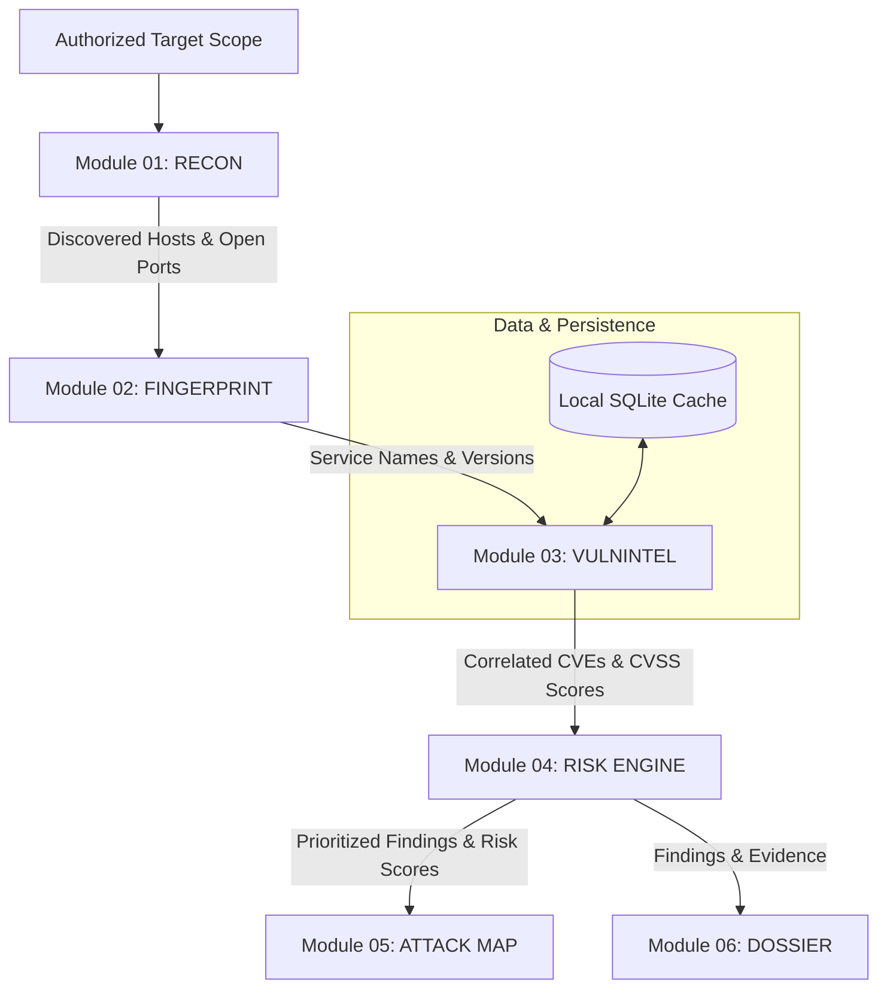

# PHANTOM — System Architecture & Data Flow

This document outlines the architectural specifications, component relationships, data contracts, and design principles of the PHANTOM platform.

---

## 1. High-Level System Architecture

PHANTOM is structured as a pipeline of modular security engines:

---

## 2. Core Modules & Responsibilities

| Module | Core Responsibility | Input | Output |
|---|---|---|---|
| **01. RECON** | Host and port discovery | IP Address / CIDR Subnet | List of open ports (`Host:Port`) |
| **02. FINGERPRINT** | Service & protocol detection | Open Ports | Identified services & versions |
| **03. VULNINTEL** | CVE matching via NIST NVD | Software versions | Matched CVEs + CVSS vectors |
| **04. RISK ENGINE** | Contextual risk calculation | Vulnerability & asset metadata | Prioritized risk score (0.0–10.0) |
| **05. ATTACK MAP** | Graph-theoretic exposure mapping | Structured scan results | Interactive node-link topology |
| **06. DOSSIER** | Automated PDF reporting | Full scan & risk report | Professional PDF document |

---

## 3. Security Guardrails

* **Allowlist Enforcement:** All outbound network operations must pass through an authorization check. Scanning unapproved public IP ranges is blocked at the core API level.
* **Rate Limiting:** Scanners must implement configurable pacing to prevent Denial of Service (DoS) conditions on local networks.
* **Input Sanitization:** User-supplied inputs (IPs, hostnames, port lists) are strictly validated via Python's `ipaddress` library and regex schemas to prevent command injection.
